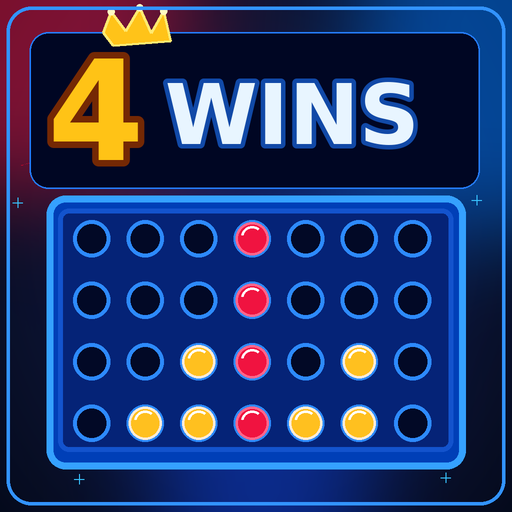
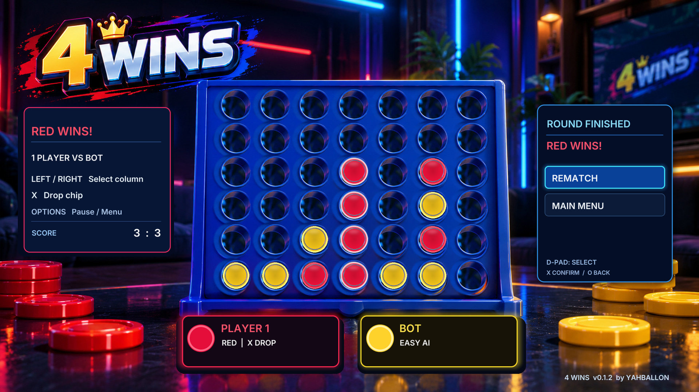

<div align="center">



# 4 WINS

**Connect Four, reborn for PS5 Homebrew.**

**by YAHBALLON · v0.1.2 · PPSA99858**

[](https://github.com/Yahballon/4Wins/actions/workflows/build.yml)
[](https://github.com/Yahballon/4Wins/releases)
[](LICENSE)

**[Download latest release](https://github.com/Yahballon/4Wins/releases/latest)** · **[Source code](https://github.com/Yahballon/4Wins)**

</div>

---

## 🎮 Gameplay screenshot

Real PS5 gameplay screenshot from **v0.1.2**, showing the neon lounge, 7×6 board, result overlay and bot mode.



## About the game

**4 WINS** is a native, offline, four-in-a-row homebrew game for compatible, jailbroken PlayStation 5 consoles. Drop red or yellow chips into a **7-column, 6-row** board. The first to connect four horizontally, vertically, or diagonally wins.

Everything is controlled from the DualSense using the **[ps5-homebrew-ui](https://github.com/Yahballon/ps5-homebrew-ui)** renderer and input toolkit. The visual style features a vibrant neon arcade lounge, glossy chips, full-screen game view and clear UI overlays.

### Highlights

- **Local 2-player:** take turns with a shared DualSense.
- **1-player vs bot:** Easy (casual), Medium (tactical), Hard (minimax / alpha-beta pruning).
- **PS5-native graphics:** high-resolution photographed board, animated chips, focus transitions and player indicators.
- **Fixed chip positioning:** precise alignment for all 42 sockets.
- **Clean menu system:** Start Game, Game Mode, Settings, Pause, Result, Rematch and Exit.
- **Saved settings and scores:** `/data/4WINS/settings.ini`.
- **Diagnostics:** `/data/4WINS/logs/4wins.log`.
- **Offline:** no account or network connection required for gameplay.

## 🕹️ Controls

| Screen | Control | Action |
|:--|:--|:--|
| Main menu | D-Pad ↑ / ↓ or left stick | Select option |
| Menus | **✕** | Confirm |
| Menus | **◯** | Back |
| Game | D-Pad ← / → or left stick | Select column |
| Game | **✕** | Drop chip |
| Game | **L1 / R1** | Jump to first / last column |
| Game | **OPTIONS** | Open pause menu |
| Pause | D-Pad ↑ / ↓, **✕** | Resume, Restart, Main Menu |
| Results | D-Pad ↑ / ↓, **✕** | Rematch or Main Menu |

## 📦 Installation

1. Download **`PPSA99858.zip`** from the [Releases page](https://github.com/Yahballon/4Wins/releases).
2. Extract the zip and copy the **`PPSA99858`** folder to the homebrew installation location supported by your jailbroken PS5 (commonly `/data/homebrew/`).
3. Open **4 WINS** through your installed homebrew launcher / mounting setup.

> Requires a compatible PS5 jailbreak and native homebrew environment. This is an **unofficial homebrew project**, not affiliated with Sony.

## 🛠️ Build from source

Native build is automated by [GitHub Actions](.github/workflows/build.yml). The workflow builds using the open-source [PS5-DevBridge](https://github.com/Yahballon/PS5-DevBridge) native template, [ps5-homebrew-ui](https://github.com/Yahballon/ps5-homebrew-ui), the PS5 payload SDK and pinned PS5 OpenGL SDK.

The workflow:
1. Tests game rules, controller navigation and board alignment on the host.
2. Prepares the native PS5 SDK and OpenGL runtime.
3. Generates game sprites, stages `assets/scene_game.jpg` and copies the custom `assets/icon0.png` into `sce_sys/icon0.png`.
4. Cross-compiles, signs, and packages **`PPSA99858.zip`**.
5. Publishes `v0.1.2` automatically following a successful `main` build.

Run local C++ tests on Linux:

```bash
for name in game controls geometry; do
  g++ -std=c++20 -O2 -Wall -Wextra -Werror -pedantic \
    "tests/${name}_test.cpp" -o "/tmp/4wins-${name}-test"
  "/tmp/4wins-${name}-test"
done
```

## 📁 Repository layout

```text
4Wins/
├── .github/workflows/build.yml
├── assets/
│   ├── icon0.png             # PS5 home tile artwork
│   ├── scene_game.jpg        # Cleaned neon gameplay scene
│   └── generate_assets.py   # Chip textures and packaging
├── native/
│   ├── main.cpp             # PS5 runtime + UI
│   ├── game.hpp             # Connect Four rules and bot
│   ├── controls.hpp         # Controller and menu navigation
│   └── board_layout.hpp     # Calibrated 7×6 socket locations
├── screenshots/
│   └── 1.jpg                # Real PS5 screenshot
├── tests/                   # Host-side regression tests
├── app.json
├── RELEASE_NOTES.md
└── LICENSE
```

## ✨ v0.1.2

- Corrected chip placement, winning highlights and drop trajectories.
- Removed baked duplicate text from the menu and player panels.
- Improved game/pause/results screen separation and menu navigation.
- Added a new PS5 cover icon and dedicated source repository.
- Preserved local two-player and three AI difficulties.

## Credits and license

Developed by **YAHBALLON**. Built with **ps5-homebrew-ui**, **PS5-DevBridge** and community PS5 homebrew tooling. The included code follows the repository's [GPL-3.0 license](LICENSE); third-party dependencies retain their own licenses.

---
<div align="center"><sub>4 WINS · PS5 HOMEBREW · by YAHBALLON</sub></div>
